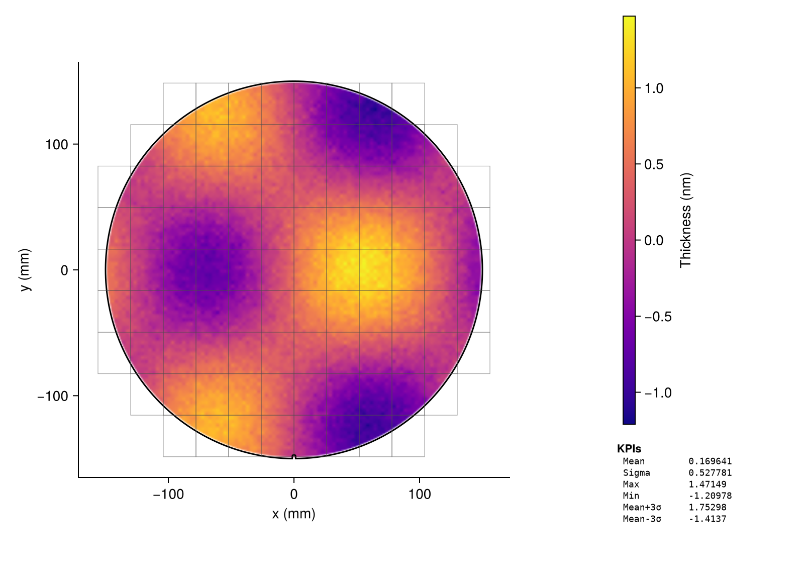
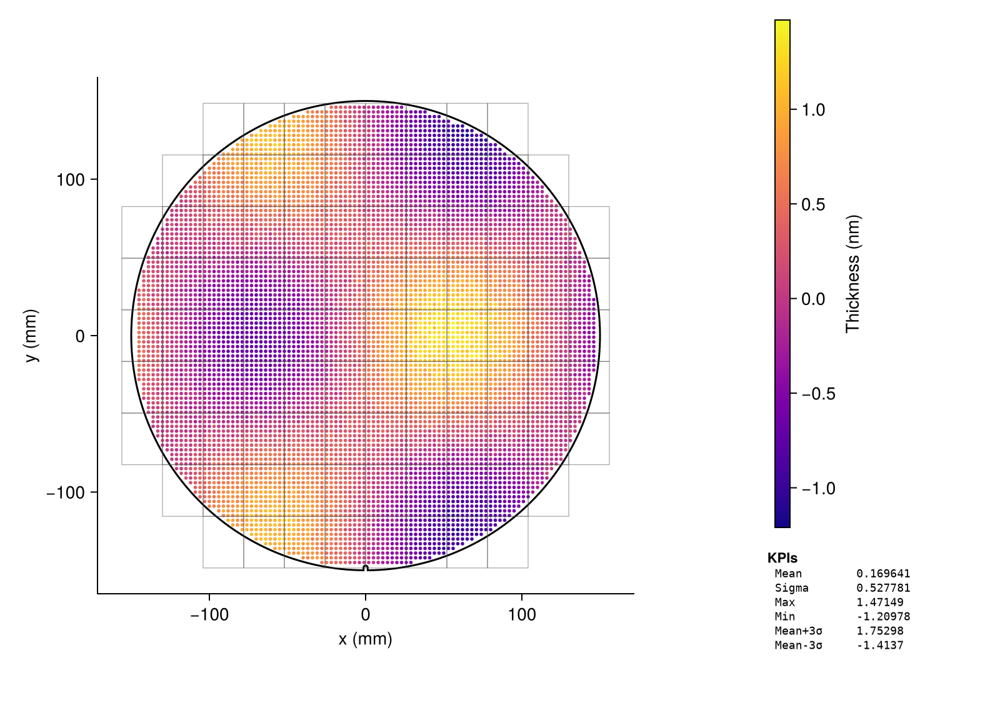
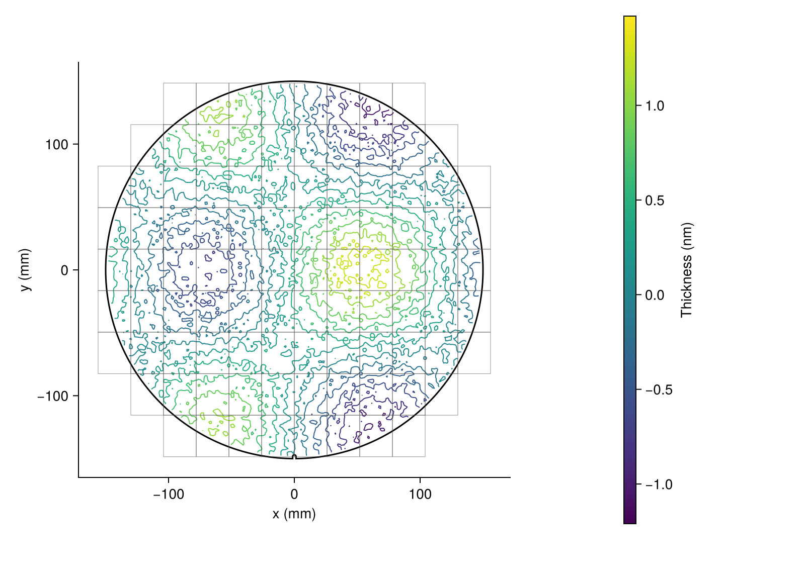
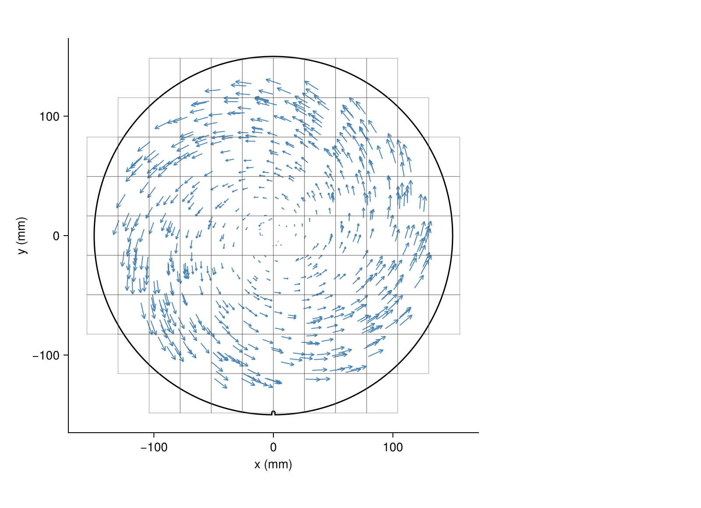
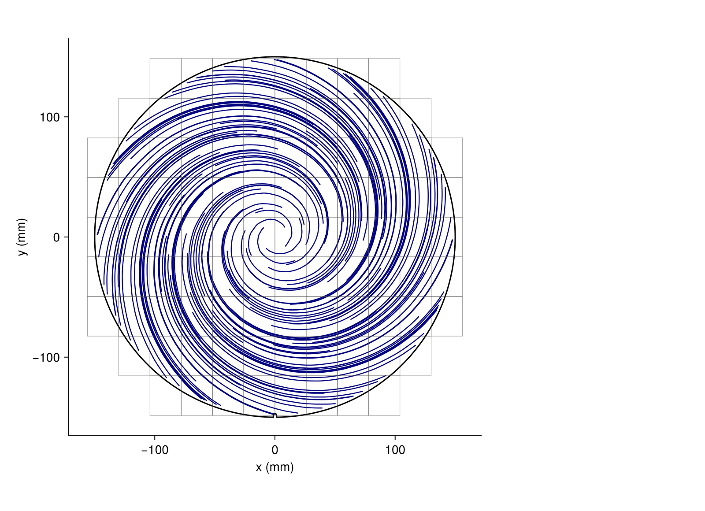
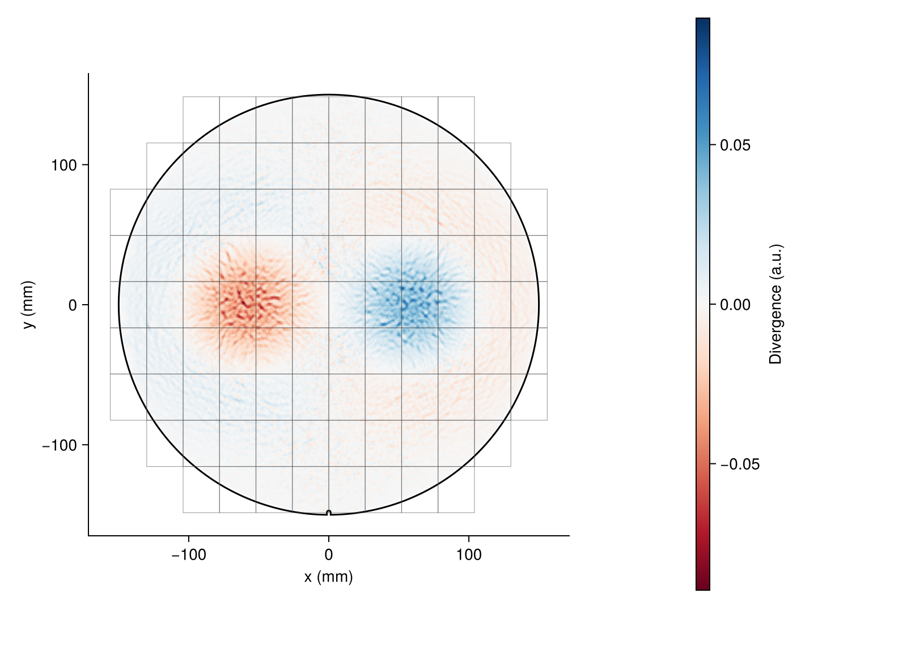
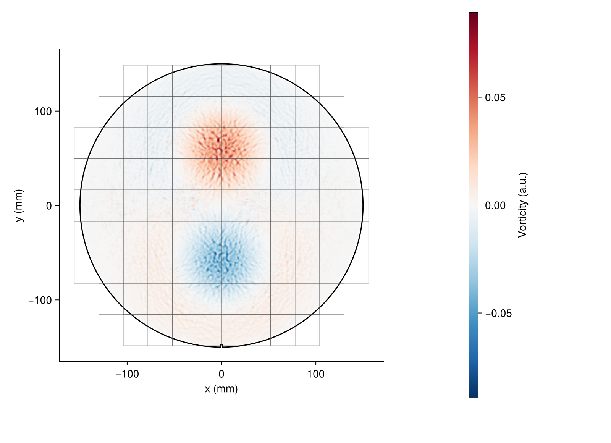

# LithoWaferPlots.jl

[](https://juliahub.com/ui/Packages/General/LithoWaferPlots)
[](https://github.com/el-oso/LithoWaferPlots.jl/actions/workflows/CI.yml)
[](https://coveralls.io/github/el-oso/LithoWaferPlots.jl?branch=master)
[](https://el-oso.github.io/LithoWaferPlots.jl/dev/)
[](LICENSE)

Open-source semiconductor wafer map visualization for Julia.



## Features

- **Seven plot types** — scatter, heatmap, contour, arrows, streamlines, divergence, vorticity
- **Field and die overlays** — rectangular exposure-field boundaries on any plot
- **KPI panel** — built-in metrics (mean, sigma, min, max, P99, ±3σ) with a clean extension contract
- **Any tabular input** — DataFrames, NamedTuples, CSV rows, or plain arrays via Tables.jl
- **mm and die-index coordinates** — automatic conversion from col/row to wafer mm
- **Fast rendering** — `image!` GPU texture path for dense heatmaps (>5K points); target 300K pts < 0.3 s on GLMakie
- **Backend-agnostic** — works with CairoMakie, GLMakie, and WGLMakie; Makie is a weak dependency

## Installation

```julia
using Pkg
Pkg.add("LithoWaferPlots")
Pkg.add("CairoMakie")   # or GLMakie / WGLMakie
```

## Quick start

```julia
using LithoWaferPlots
using CairoMakie          # any Makie backend

# 300 mm wafer, notch at bottom by default; pass `wafer = WaferSpec(...)` for others.
# A Tables.jl source (DataFrame, CSV.File, …) works too: WaferData(df)
data = WaferData(meas_x, meas_y, meas_v)

fig, ax, p = wafer_figure(data; label="Thickness (nm)", colormap=:plasma)
save("wafer.png", fig)
```

## Plot gallery

| Scatter | Heatmap | Contour |
|:---:|:---:|:---:|
|  |  |  |

| Arrows | Streamlines | Divergence | Vorticity |
|:---:|:---:|:---:|:---:|
|  |  |  |  |

## Die-index mode

```julia
grid = DieGrid(-75.0, -75.0, 5.0, 5.0)   # origin (mm from centre), die pitch (mm)
data = WaferData(df, grid)                 # df has :col, :row, :value columns
```

## Field overlays

Pass a `fields` vector to draw exposure-field or die-boundary rectangles on any plot:

```julia
centers = [((ci - 0.5) * 26.0, (ri - 5) * 33.0) for ri in 1:9, ci in -5:6]
fields = field_grid(centers, (26.0, 33.0); wafer = WaferSpec())   # drops fields off the wafer

data = WaferData(table; fields)
p = waferheatmap!(ax, data)
```

## Custom KPIs

```julia
struct MyRange <: AbstractKPI end
LithoWaferPlots.name(::MyRange)    = "Range"
LithoWaferPlots.compute(::MyRange, v) = maximum(v) - minimum(v)

add_kpi_panel!(side, data; kpis=[KPIMean(), KPISigma(), MyRange()])
```

## Vector fields

```julia
vdata = WaferVectorData(xs, ys, vxs, vys)

waferarrows!(ax, vdata; lengthscale=2.0)
waferstreamlines!(ax, vdata; n_seeds=12, max_steps=80)
waferdivergence!(ax, vdata; colormap=:RdBu)
wafervorticity!(ax, vdata)
```

## Running tests

```julia
julia --project=test test/runtests.jl
```

## License

MIT — see [LICENSE](LICENSE).

## Acknowledgements

Built from free, open resources:
[cap1tan/wafermap](https://github.com/cap1tan/wafermap) (MIT) ·
[dougthor42/wafer_map](https://github.com/dougthor42/wafer_map) (MIT) ·
[xlhaw/wfmap](https://github.com/xlhaw/wfmap) (MIT) ·
[Wikipedia: Substrate mapping](https://en.wikipedia.org/wiki/Substrate_mapping) ·
SEMI M20/M21 coordinate conventions
